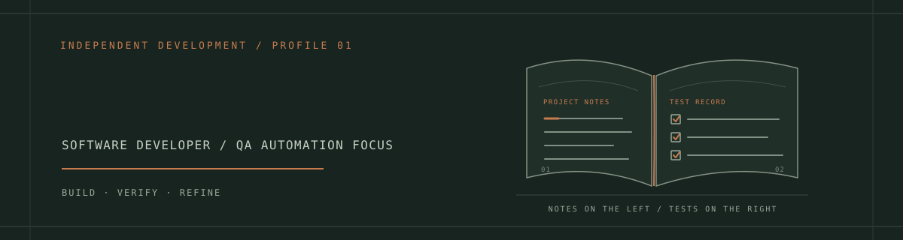

  

  <a href="https://github.com/shimleabyte?tab=repositories">ALL REPOSITORIES</a>
  &nbsp; · &nbsp;
  <a href="https://github.com/shimleabyte/hold-the-keep">FEATURED PROJECT</a>
  &nbsp; · &nbsp;
  <a href="https://github.com/shimleabyte/optical-anchor-button">COMPONENT STUDY</a>

<table>
  <tr>
    <td width="50%" valign="top">
      
LEFT PAGE / 01

      <h2>Interaction &amp; systems</h2>

      <h3><a href="https://github.com/shimleabyte/hold-the-keep">Hold the Keep</a></h3>
      
Godot 4.7 · GDScript

      
A strategy game with headless regression checks in GitHub Actions.

      
<strong>Test coverage</strong> Combat, save/load, resources, worker behavior, campaign progression, input, and responsive layouts.

      
<strong>Core concepts</strong> Assertions, repeatable scenarios, state validation, regression testing, and performance diagnostics.

      

      <h3><a href="https://github.com/shimleabyte/optical-anchor-button">Optical Anchor Button</a></h3>
      
React · TypeScript · Vitest

      
An interactive button component with pointer-driven states and native button behavior.

      
<strong>Test coverage</strong> Component behavior, activation, disabled and loading states, and the eye's wake-to-sleep lifecycle. Its standalone prototype also has a documented 12-check Chromium validation run.

      
<strong>Core concepts</strong> Component contracts, event handling, state lifecycles, keyboard semantics, and reduced motion.

    </td>
    <td width="50%" valign="top">
      
RIGHT PAGE / 02

      <h2>Data &amp; domain</h2>

      <h3><a href="https://github.com/shimleabyte/mutabaah-cli">Mutabaah CLI</a></h3>
      
Go · JSON · CLI

      
A local CLI for activity tracking and notes, with separate domain, command, and storage responsibilities.

      
<strong>Test coverage</strong> Input validation, CLI behavior, CRUD operations, JSON storage, and race-enabled tests.

      
<strong>Core concepts</strong> Input boundaries, error handling, persistence, separation of concerns, and unit testing.

      

      <h3><a href="https://github.com/shimleabyte/simpul">Simpul</a></h3>
      
Go · Domain Modeling

      
An early order-workflow backend focused on business rules. PostgreSQL persistence is planned and is not connected yet.

      
<strong>Test coverage</strong> Integer currency calculations, invalid input, overflow, input ownership, and order-state transitions.

      
<strong>Core concepts</strong> Domain invariants, boundary testing, state-transition rules, and defensive data handling.

    </td>
  </tr>
</table>

<table>
  <tr>
    <td width="50%" valign="top">
      
CURRENT FOCUS

      <strong>Test design</strong> · Regression testing · Browser automation · CI workflows
    </td>
    <td width="50%" valign="top">
      
TOOLKIT

      Go · TypeScript · React · Vitest · Playwright · GitHub Actions · Godot · GDScript
    </td>
  </tr>
</table>

MORE WORK 
<a href="https://github.com/shimleabyte?tab=repositories">All repositories</a> ·
<a href="https://github.com/shimleabyte/osbio">OSBio</a> ·
<a href="https://github.com/shimleabyte/log-salary-tracker">Teacher Log &amp; Salary Tracker</a>

Independent development · 2024–present

