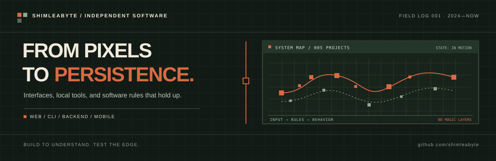
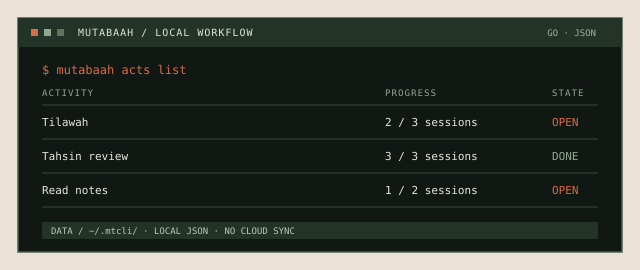
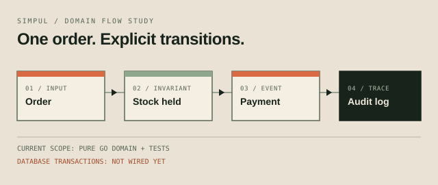
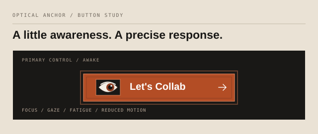
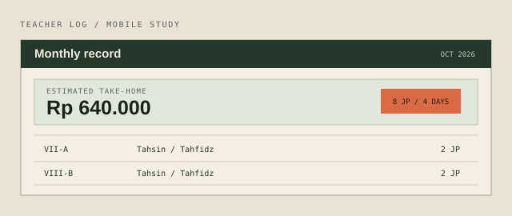
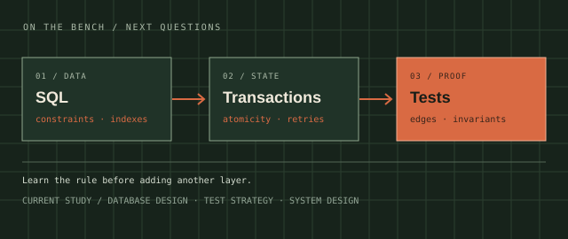

  
  

    <a href="https://shimleabyte.github.io/osbio/"><strong>OPEN THE DESKTOP</strong></a>
    &nbsp; / &nbsp;
    <a href="https://github.com/shimleabyte?tab=repositories">BROWSE THE REPOS</a>
  

I work where interface behavior meets system rules: browser interactions, local-first tools, persistence, and domain logic. I want to know what a system does, why it does it, and which edge case will break it.

---

01 / SELECTED WORK

<table>
  <tr>
    <td width="50%" valign="top">
      
      
01 — INTERFACE SYSTEM

      <h3><a href="https://github.com/shimleabyte/osbio">OSBio / Pixel-Flow Workstation</a></h3>
      
A portfolio that behaves like a desktop instead of a landing page: icon-only shell chrome, a custom split-corner outline system, eleven-icon launcher, draggable windows, and local-first workspace apps. The project README includes real Chromium captures of both the desktop and launcher.

      
<code>HTML</code> <code>CSS</code> <code>Vanilla JavaScript</code> <code>IndexedDB</code> <code>Playwright</code>

      
<a href="https://github.com/shimleabyte/osbio">Source ↗</a> · <a href="https://shimleabyte.github.io/osbio/">Live desktop ↗</a> · <a href="https://github.com/shimleabyte/osbio#screenshots">Screenshots ↗</a>

    </td>
    <td width="50%" valign="top">
      
      
02 — LOCAL-FIRST TOOL

      <h3><a href="https://github.com/shimleabyte/mutabaah-cli">Mutabaah CLI</a></h3>
      
A Go terminal app with separate activity and notes workflows. Local JSON storage, input validation, explicit state, and tests; no cloud service or third-party runtime dependencies.

      
<code>Go</code> <code>JSON</code> <code>CLI</code> <code>Testing</code>

      
<a href="https://github.com/shimleabyte/mutabaah-cli">Inspect the implementation ↗</a>

    </td>
  </tr>
  <tr>
    <td width="50%" valign="top">
      
      
03 — BACKEND DOMAIN

      <h3><a href="https://github.com/shimleabyte/simpul">Simpul</a></h3>
      
A reliability-first Go backend starter for order and payment workflows used by small-batch sellers. The domain model and tests exist; transactional database persistence is a later milestone, not a claimed feature.

      
<code>Go</code> <code>Domain Modeling</code> <code>PostgreSQL</code>

      
<a href="https://github.com/shimleabyte/simpul">Follow the build ↗</a>

    </td>
    <td width="50%" valign="top">
      
      
04 — INTERACTION STUDY

      <h3><a href="https://github.com/shimleabyte/optical-anchor-button">Optical Anchor Button</a></h3>
      
A button built around a custom eye: pointer-responsive gaze, fatigue states, keyboard focus, reduced-motion support, and a precision-hardware surface. Includes React and standalone HTML work.

      
<code>React</code> <code>TypeScript</code> <code>SVG</code> <code>Vanilla JS</code>

      
<a href="https://github.com/shimleabyte/optical-anchor-button">See the component study ↗</a>

    </td>
  </tr>
  <tr>
    <td width="50%" valign="top">
      
      
05 — MOBILE UTILITY

      <h3><a href="https://github.com/shimleabyte/log-salary-tracker">Teacher Log &amp; Salary Tracker</a></h3>
      
A Flutter logbook for teaching sessions and estimated monthly pay. Device-local persistence and an ARM 32-bit Android target; static analysis and release build still need to be run in a Flutter-enabled environment.

      
<code>Flutter</code> <code>Dart</code> <code>Android ARMv7</code>

      
<a href="https://github.com/shimleabyte/log-salary-tracker">Inspect the app source ↗</a>

    </td>
    <td width="50%" valign="top">
      
      
06 — CURRENT WORKBENCH

      <h3>Follow the behavior to the edge.</h3>
      
Current study: SQL and database design, transactions and retries, test strategy, data structures, and system design. The aim is to prove the rules before adding infrastructure around them.

      
<code>Data Modeling</code> <code>Failure Paths</code> <code>Invariants</code>

    </td>
  </tr>
</table>

---

02 / DEFAULTS I WORK BY

<table>
  <tr>
    <td width="33%" valign="top">
      
<strong>01 / State first</strong>

      
Make transitions and invalid states explicit before adding visual polish.

    </td>
    <td width="33%" valign="top">
      
<strong>02 / Keep the seam visible</strong>

      
Separate domain rules, command or UI handling, and persistence so each can be inspected.

    </td>
    <td width="33%" valign="top">
      
<strong>03 / Test the awkward case</strong>

      
Retries, invalid input, empty data, and edge states belong in the design — not in the postmortem.

    </td>
  </tr>
</table>

03 / TOOLKIT

<strong>Web</strong> &nbsp; HTML · CSS · JavaScript · React · TypeScript 
<strong>Systems</strong> &nbsp; Go · CLI design · JSON persistence · REST APIs 
<strong>Mobile</strong> &nbsp; Flutter · Dart 
<strong>Workflow</strong> &nbsp; Git · automated tests · browser validation

04 / ELSEWHERE

<a href="https://github.com/shimleabyte">GitHub profile ↗</a> &nbsp; / &nbsp; <a href="https://shimleabyte.github.io/osbio/">OSBio portfolio ↗</a>

SHIMLEABYTE / INDEPENDENT DEVELOPMENT / BUILT SINCE 2024

